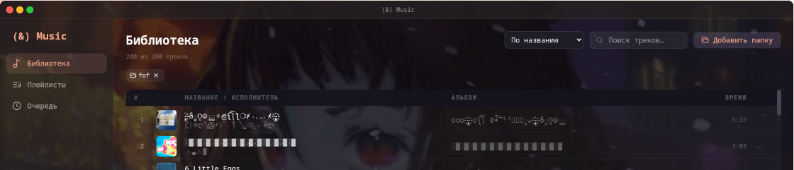
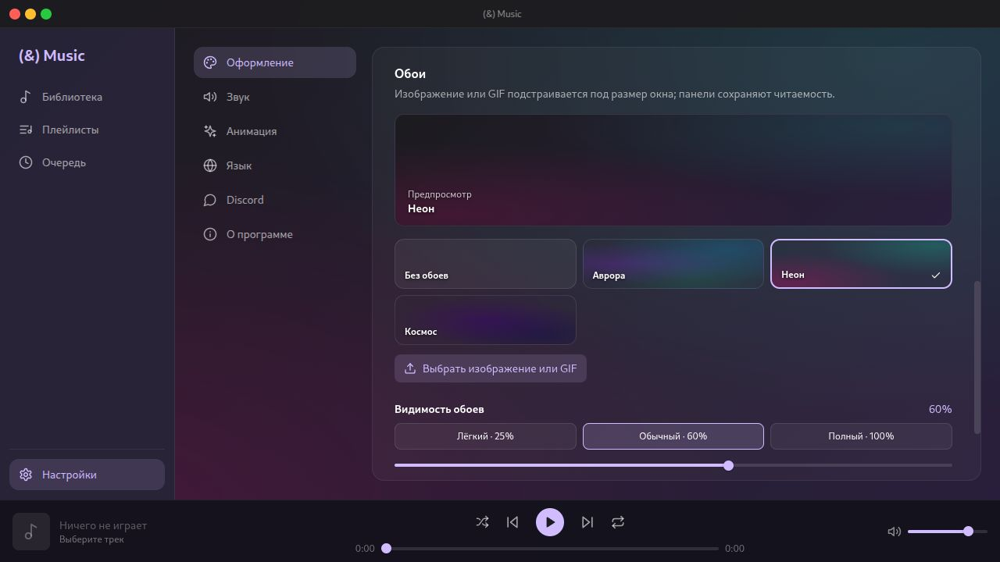
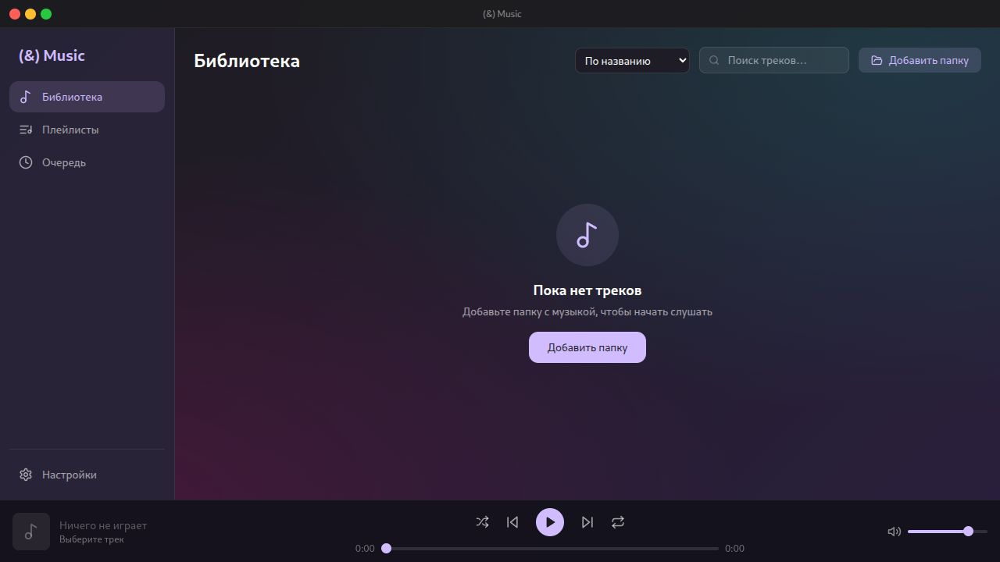

# (&) Music

Локальный музыкальный плеер для рабочего стола на Electron, React и TypeScript.

## Возможности

- Несколько музыкальных папок с обновлением библиотеки при изменении файлов.
- Чтение метаданных и обложек, поиск и сортировка треков.
- Воспроизведение, перемотка, громкость, перемешивание и повтор.
- Плейлисты, очередь с командами «Играть следующим» и «Добавить в конец».
- Сохранение очереди между запусками и горячие клавиши: пробел — пауза/воспроизведение, Ctrl + ←/→ — смена трека.
- Темы и обои, включая GIF; русский и английский интерфейс.
- Необязательный статус воспроизведения в Discord.

## Скриншоты

### Библиотека с пользовательскими обоями



### Настройки оформления



### Первый запуск



## Разработка

Требуется Node.js и npm. Установите зависимости на той системе, где будете запускать приложение:

```bash
npm ci --include=optional
npm run dev
```

Проверка типов и production-сборка:

```bash
npx tsc --noEmit
npm test
npm run build
```

Запуск собранной версии: `npm start`. Для разработки используйте `npm run dev`.
Дополнительное слово после `npm start` передаётся в electron-vite как аргумент, поэтому обычно оно не нужно.

`npm run dist` собирает установщик Windows через electron-builder. Конфигурация упаковки находится в `electron-builder.yml`.

Linux AppImage собирается командой `npm run dist:linux` в папку `bin`. Иконка Windows — `resources/icon.ico`; для Linux используется `resources/icon.png`, полученный из кадра 256×256 того же `.ico`.

## Структура

- `src/main` — окно приложения, IPC и сканирование файлов.
- `src/preload` — ограниченный API для интерфейса.
- `src/renderer` — интерфейс React.
- `resources/icon.ico` и `resources/icon.png` — иконки Windows и Linux.
- `out` и `dist` — генерируемые файлы, исключённые из репозитория.

Дополнительные заметки о дизайне и планах находятся в `DESIGN_REFERENCE.md` и `TODO.md`.

## Скачать

Готовые установщики для Windows и Linux доступны в [релизе v1.0.0](https://github.com/0-nerop-0/and-music/releases/tag/v1.0.0). Для Arch Linux используйте пакет `and-music-bin-1.0.0-1-x86_64.pkg.tar.zst` или установщик `.bin`.

Исходный код распространяется по лицензии MIT — см. `LICENSE`.
